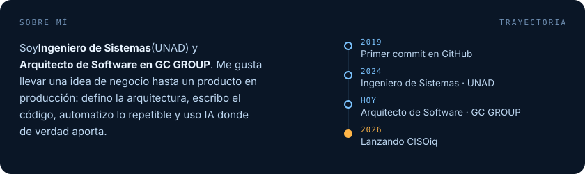
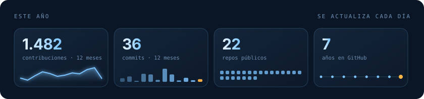
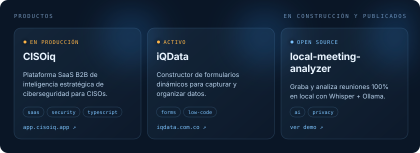
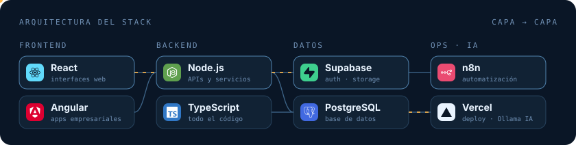

<!-- Perfil generado por scripts/build.mjs (tema Aurora Blueprint). Se actualiza cada día con .github/workflows/build-profile.yml -->

  <a href="https://app.cisoiq.app">CISOiq</a> ·
  <a href="https://iqdata.com.co">iQData</a> ·
  <a href="https://github.com/edixon-javier/local-meeting-analyzer">local-meeting-analyzer</a>

  
  &nbsp;
  

